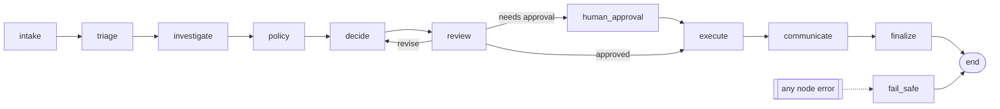

# Harness design: loops, graphs, routing, context, reliability

This document explains how Matchpoint is put together and why. The short version: **models propose, deterministic
code disposes**. Control flow, money movement and anything a controller signs off on live in plain code. LLMs do the
work that needs judgment (investigating, reading policy, deciding, explaining, writing) inside that structure.

## 1. Workflow outside, agents inside

The graph is a fixed workflow (`agents/workflow.py`):



Inside four of the nodes is an agentic loop (`harness/loop.py`) that chooses its own tool calls. The split is deliberate:

| Concern | Who decides | Why |
|---|---|---|
| Which step runs next | graph (code) | Auditable, testable, cannot be talked out of a review |
| Which evidence to gather | investigator agent | Open-ended: the exception code is only a hint |
| Which policy applies | analyst agent + BM25 | Needs reading; citations must be grounded |
| What resolution to propose | resolver agent | Judgment over findings and rules |
| Whether the proposal is allowed | policy engine (code) | Invariants a controller signs off on |
| Whether it is sensible | reviewer agent | Second opinion on rationale and fit |
| Whether money moves | executor (code) | Idempotent, re-checked against fresh ERP facts |

A purely autonomous agent with an "approve_payment" tool would be simpler to write and much harder to trust. A purely
deterministic pipeline could not handle messy evidence. The hybrid gets both.

## 2. The agent loop

`AgentLoop.run(spec, brief)` takes a role spec (system prompt, tool subset, terminal tool, output model) and a brief:

```
brief -> [model -> tool calls -> tool results]* -> terminal tool -> validated artifact
```

Controls, each with a test in `tests/test_harness.py` or `tests/test_reliability.py`:

- **Terminal tools as the output contract.** Each role ends by calling `submit_<artifact>` whose input schema is the
  pydantic model of its artifact. The loop validates it; a validation error goes back to the model as an `is_error`
  tool result naming the bad fields, so the model repairs it (`validation_repair`).
- **No forced tool choice.** The 5.5-generation models reject forced `tool_choice`, so `tool_choice` stays `auto`.
  If the model ends a turn in prose, the loop nudges it (twice at most) to call the terminal tool (`nudges`).
- **Strict schemas.** Tool schemas are generated from pydantic, refs inlined, objects closed and every field required
  (`tools/base.py:strict_schema`), and sent with `strict: true`. Validation still runs on our side.
- **Loop guard.** An identical call beyond three times returns an error result instead of executing again.
- **Parallel tool calls.** Independent read-only calls in one turn run concurrently and all results go back in one
  user message.
- **Budgets.** Every model call is preceded by a budget check (calls, tokens, USD, wall clock). Exceeding any limit
  raises, and the graph fails closed.
- **Turn limits per role.** The loop always terminates.

## 3. The state graph

`harness/graph.py` is ~200 lines: `add_node`, `add_edge`, `add_conditional_edges`, `set_entry`, `set_error_handler`,
`compile(checkpointer)`. Properties that matter in production:

- **Checkpoint after every node.** The full typed `CaseState` is written to SQLite with the name of the next node.
- **Interrupts.** A node can return `Interrupt(...)`. The run stops with status `interrupted`; `resume(run_id, value)`
  re-runs the same node with `ctx.resume_value` set, which is LangGraph's `interrupt()` contract. Controller approval
  above the 25,000 release limit uses this. The run can wait for days; nothing is held in memory.
- **Crash recovery.** If the process dies mid-node, the last checkpoint names the node to re-run. Nodes with side
  effects are idempotent: every ERP write goes through `ERP.apply(idempotency_key=...)`, which inserts the audit row
  and the business rows in one transaction. `test_crash_after_write_then_resume_does_not_double_pay` kills the
  process right after the payment write and before the checkpoint, resumes, and checks there is exactly one payment.
- **Fail closed.** Any unhandled node error routes to `fail_safe`, which escalates the invoice to the controller
  (AP-POL-1.3) and never pays. If execution already happened, it records the error and leaves the completed write alone.
- **Cycle protection.** `max_steps` bounds the revise loop and anything else.

### Why not LangGraph here?

The graph maps one-to-one onto LangGraph:

| Matchpoint | LangGraph |
|---|---|
| `StateGraph(CaseState)` | `StateGraph(CaseState)` (pydantic state) |
| `add_node / add_edge / add_conditional_edges` | same names |
| `Interrupt` returned by a node + `resume(run_id, value)` | `interrupt(payload)` + `Command(resume=value)` |
| `Checkpointer` (SQLite) | `SqliteSaver` / `PostgresSaver` |
| `set_error_handler("fail_safe")` | try/except in nodes + a conditional edge |

For a client already on LangGraph I would build on it. Here, owning the ~200 lines kept three things explicit and easy
to review: exactly-once side effects across crash/resume, a single fail-closed error route, and zero framework
dependencies in the control path. The node functions are plain `(state, ctx) -> dict`, so porting is mechanical.

## 4. Multi-agent hand-offs: typed artifacts, not transcripts

Agents never see each other's transcripts. Each one receives a compact `<case_context>` JSON brief built from earlier
artifacts (`InvoiceSnapshot`, `Findings`, `PolicyAnalysis`, `Resolution`) and returns its own artifact. This:

- keeps every context small and focused, and cheap to cache;
- makes every hand-off inspectable in the UI and gradable in evals (diagnosis accuracy, retrieval recall,
  first-pass accuracy are measured per component);
- stops one agent's confusion from leaking into the next agent's prompt.

## 5. Model routing

`llm/router.py`:

1. Role -> tier from config (`fast` Haiku 5.5, `balanced` Sonnet 5.5, `frontier` Opus 5.5).
2. Risk escalation: the resolver moves to the frontier tier when the case is high risk. Risk only goes up: a
   deterministic floor (amount over 10,000 or injection detected) is applied to triage's guess, and the investigation
   raises it on bank-detail risk or suspicious instructions.
3. Retries with full-jitter exponential backoff, honouring `retry-after`. SDK retries are off so every attempt is a
   span and counts against the budget.
4. Per-model circuit breakers (closed -> open after N consecutive failures -> half-open probe).
5. Fallback chain per tier on exhausted retries, refusals or an open circuit. For models that support it, server-side
   refusal fallbacks (`fallbacks: "default"`) are enabled too.
6. Every attempt records model, tokens (including cache reads/writes), cost, latency and the tool calls it made.

## 6. Context management

- **Briefs, not history.** See section 4.
- **Truncate at insertion, page on demand.** Tool results over the limit are cut when they are first appended. The full
  text is parked in a per-run store and the model can page it with `read_result(ref, offset)`.
- **Append-only history.** Nothing already sent is edited. That keeps the prompt cache valid turn to turn and keeps
  thinking blocks replayable (assistant content goes back exactly as returned).
- **Prompt caching.** System prompt and tool definitions carry `cache_control`. They are static per role, so they are
  cached across turns and across runs.
- **Soft limit nudge.** Near the role's token budget, the loop tells the model to submit with what it has.

## 7. Memory

Long-term memory is per vendor (`vendor_memory`) and is **written only by deterministic code** (`finalize`) from the
verified outcome of a run, never by a model. Agents read it with `recall_vendor_history`. That closes the
memory-poisoning path where injected text persuades an agent to "remember" a false bank change.

## 8. Provider abstraction and the reference model

`Provider.complete(LLMRequest) -> LLMResponse` has four implementations:

- `AnthropicProvider`: Claude via the official SDK (`client.messages` / `client.beta.messages`).
- `SimProvider`: a deterministic reference policy that speaks the same tool-calling protocol. It runs the whole harness
  in CI with no key and no cost, and it validates the eval set: if the reference policy does not score 100%, a label or
  grader is wrong. Knobs (`mistake_rate`, `gullible`) turn it into an adversarial model for ablations.
- `ChaosProvider`: wraps any provider and injects 429/529/5xx/timeouts plus malformed arguments, unknown tools and
  turns without tool calls.
- `CassetteProvider`: records a live run and replays it byte-for-byte in CI.

## 9. What I would add for a real client

- Postgres for checkpoints and traces; a queue (SQS/Service Bus/Pub/Sub) in front of the run workers.
- The ERP gateway against the client's system (SAP OData, Oracle Fusion REST, NetSuite SuiteTalk) behind the same
  read/write split, with the executor as the only writer.
- Hybrid retrieval (BM25 + embeddings + reranker) once the policy corpus is bigger than a manual.
- SSO for the approval UI, with approver identity from the identity provider.
- Online evals on sampled production traces, and drift alerts on component metrics.
